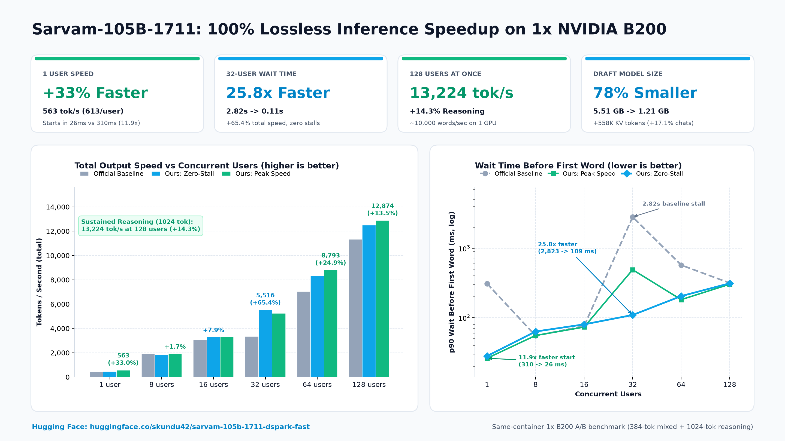

# sarvam-105-dspark-fast

100% lossless inference optimization for [`sarvamai/sarvam-105b-1711`](https://huggingface.co/sarvamai/sarvam-105b-1711) on `1x NVIDIA B200` using stock `vLLM 0.34.0` (no custom vLLM fork or patches needed).

- **Pre-built 1.21 GB draft checkpoint (Hugging Face)**: [skundu42/sarvam-105b-1711-dspark-fast](https://huggingface.co/skundu42/sarvam-105b-1711-dspark-fast)
- **Target accuracy**: 100% lossless (target 105B weights untouched, exact speculative verification, `12/12` top-1 token match with `0.00000` logprob diff)



## What We Improved

1. **Removed duplicate draft weights + dropped the 0.92 VRAM cap**: Stripped `4.3 GB` of redundant `embed_tokens` and `lm_head` tensors from stock DSpark (`5.51 GB -> 1.21 GB`, freeing `4.0 GiB` VRAM) and left `--gpu-memory-utilization` unset so vLLM's extensible KV cache reclaims another `10.9 GiB`, giving **`+17.1%` more VRAM for KV cache** (`87.0 -> 101.9 GiB`, `3.26M -> 3.82M` tokens).
2. **Unlocked `torch.compile` Inductor `mode=3` + graph-partitioned CUDA graphs**: Disabled `VLLM_USE_BREAKABLE_CUDAGRAPH=1` (which silently forced `CompilationMode.NONE`) and enabled `mode=3` with `use_inductor_graph_partition=true`, lifting 128-user sustained reasoning throughput from **`11,570 -> 13,224 tok/s` (`+14.3%`)** and 1-user speed from **`424 -> 563 tok/s` (`+33.0%`, `613 tok/s` per user)**.
3. **Switched to `TOKENSPEED_MLA` + dynamic draft lengths (`7` / `5`)**: Replaced `FLASHINFER_MLA` with Blackwell's CuTe DSL `TOKENSPEED_MLA` and native `num_speculative_tokens_per_batch_size=[[1,8,7],[9,256,5]]`, cutting 32-user p90 TTFT spikes from **`2.82s -> 0.11s` (`25.8x` faster)** and 1-user start time from **`310ms -> 26ms` (`11.9x` faster)**.
4. **On-policy TV+CE draft distillation (`0.9 TV + 0.1 CE`)**: Fine-tuned the `931M` draft weights on `2,400` on-policy `sarvam-105b-1711` rollouts across Code (`CodeFeedback`), Math (`gsm8k`), and 8 Indian languages (`aya_dataset`), directly maximizing rejection-sampling overlap (`1 - d_TV`) and re-quantizing back to bit-exact `MXFP8` (`0.000000` round-trip error).

## Quickstart (`1x B200`, `vllm==0.34.0`, `speculators==0.9.0`)

```bash
# Option 1: Peak Throughput + Max KV Cache (563/613 tok/s @ B=1, 13,224 tok/s @ B=128)
MODE=peak_tput ./serve_sarvam_track1.sh

# Option 2: Balanced Zero-Stall Low Tail Latency (TOKENSPEED_MLA + dynamic K)
MODE=balanced ./serve_sarvam_track1.sh
```

Or run `vllm serve` directly:

```bash
VLLM_USE_V2_MODEL_RUNNER=1 \
VLLM_USE_BREAKABLE_CUDAGRAPH=0 \
VLLM_ENFORCE_STRICT_TOOL_CALLING=0 \
FLASH_ATTENTION_CUTE_DSL_CACHE_ENABLED=1 \
vllm serve sarvamai/sarvam-105b-1711 \
  --trust-remote-code --tensor-parallel-size 1 \
  --max-model-len 131072 --max-num-seqs 256 --max-num-batched-tokens 8192 \
  --kv-cache-dtype fp8_e4m3 \
  --enable-auto-tool-choice --tool-call-parser glm45 --reasoning-parser glm45 \
  --enable-prompt-tokens-details \
  --compilation-config '{"mode":3,"use_inductor_graph_partition":true,"pass_config":{"fuse_rope_kvcache_cat_mla":true,"fuse_attn_quant":true,"enable_qk_norm_rope_fusion":true},"max_cudagraph_capture_size":8192}' \
  --speculative-config '{"method":"dspark","model":"skundu42/sarvam-105b-1711-dspark-fast","num_speculative_tokens":5,"draft_sample_method":"probabilistic","rejection_sample_method":"block"}'
```

## Repo Structure

- `serve_sarvam_track1.sh`: Production vLLM launcher (`MODE=peak_tput` and `MODE=balanced`).
- `optimize_dspark.py`: Local CPU script to strip duplicate `embed_tokens` and `lm_head` from any stock DSpark checkpoint (`5.51 GB -> 1.21 GB`).
- `bench_client.py`: Async multi-concurrency benchmark (`B=1..128`, 1024-tok reasoning, 8-language Indic) and `12/12` logprob lossless verifier.
- `modal_sarvam_track1.py`: End-to-end Modal `1x B200` caching, ablation, and same-container A/B benchmark runner (`uvx modal run modal_sarvam_track1.py --action final_ab`).
- `dspark_finetune.py` and `patches/sitecustomize.py`: On-policy TV+CE DSpark fine-tuning pipeline with a custom MLA hidden-state extraction hook (`uvx modal run dspark_finetune.py --action finetune`).
- `publish_hf.py`: Helper to upload a trained checkpoint to Hugging Face (`HF_TOKEN=... uvx modal run publish_hf.py`).
- `assets/`: Benchmark charts (`sarvam_105b_hero.png`, `throughput_gains.png`, `latency_and_kv.png`).

## License

Apache 2.0, matching [`sarvamai/sarvam-105b-1711`](https://huggingface.co/sarvamai/sarvam-105b-1711).
